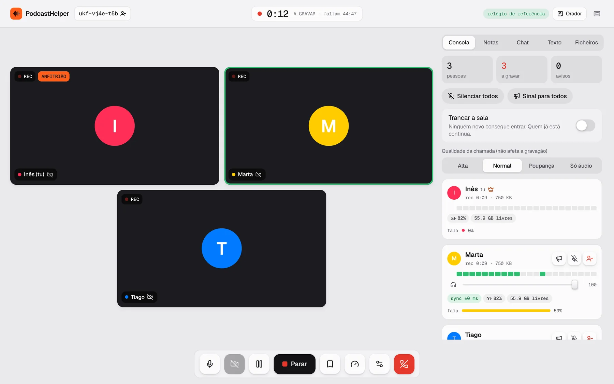
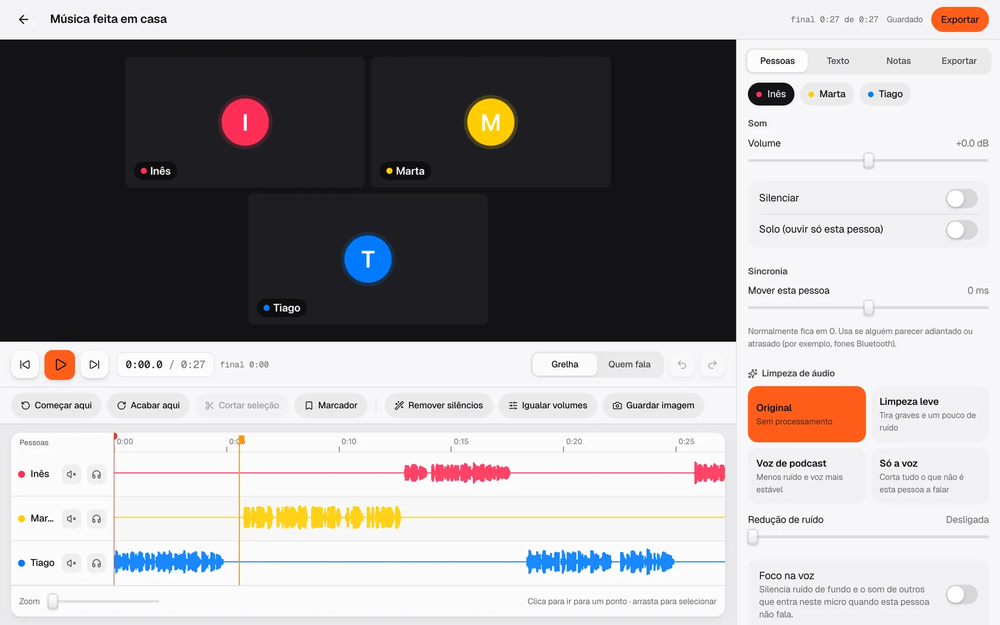

# PodcastHelper

**Estúdio de podcast remoto, grátis e open source.** Cada pessoa entra numa sala com o próprio telemóvel ou computador, grava localmente o seu micro e câmara em alta qualidade, e no fim as gravações passam diretamente de aparelho para aparelho, alinhadas ao milissegundo, prontas para editar.

**[Experimentar em podcasthelper.vercel.app](https://podcasthelper.vercel.app)** · sem contas, sem instalar nada · [APK Android](#android)

<p align="center">
  
</p>

> **English:** a free remote podcast studio. Each participant records their own mic (lossless 48 kHz WAV) and camera locally, device clocks are synced so every file starts on the same frame, and the files are exchanged peer-to-peer over WebRTC afterwards. Includes a browser editor with noise cleanup, silence removal, captions and 16:9 / 9:16 / 1:1 export.

## Como funciona

1. **Cria a sala** e partilha o link ou o QR code. Os convidados não precisam de conta.
2. **O anfitrião carrega em Gravar.** Os relógios de todos os aparelhos estão acertados entre si (sincronização tipo NTP sobre WebRTC) e a gravação começa no mesmo instante em todos, com contagem 3‑2‑1.
3. Cada aparelho grava:
   - **Áudio WAV 48 kHz sem perdas**, capturado com um AudioWorklet que começa no frame exato;
   - **Vídeo na qualidade máxima da câmara** (até 4K), em MP4 (H.264/AAC) quando o navegador suporta, ou WebM.
   Tudo é guardado aos pedaços no aparelho (IndexedDB): uma internet má não estraga a gravação e um fecho inesperado não perde o que já foi gravado.
4. **No fim, os ficheiros passam de aparelho para aparelho** por WebRTC DataChannel. Na mesma Wi‑Fi isto vai pela rede local.
5. **Editor no navegador:** ondas de som por pessoa, cortes, início/fim, volumes, mute/solo, marcadores, notas, limpeza de áudio (redução de ruído espectral, foco na voz, filtro de graves, compressor) e ajustes de imagem.
6. **Exportar:** ZIP com uma faixa WAV alinhada por pessoa + vídeos + mistura + `sync.json`; áudio final em MP3/WAV normalizado a −16 LUFS; vídeo final em grelha ou com quem fala em destaque.

## Stack

- Next.js 16 (App Router, páginas estáticas) + Tailwind CSS v4
- WebRTC (malha P2P) para a chamada, sincronização de relógio e transferência de ficheiros
- Supabase Realtime só para presença e sinalização (não guarda gravações)
- Web Audio (AudioWorklet), MediaRecorder, IndexedDB, Canvas
- Processamento de áudio próprio (FFT, redução de ruído, gate, compressor, limitador), MP3 com lamejs
- Capacitor para a app Android

## Correr localmente

```bash
cp .env.example .env.local   # URL e chave publicável de um projeto Supabase
npm install
npm run dev
```

Abre `http://localhost:3000` em dois separadores (ou dois aparelhos na mesma rede) para testar.
O micro e a câmara só funcionam em `https://` ou em `localhost`.

<p align="center">
  
</p>

## Funcionalidades

- **Sala do anfitrião:** consola com medidor de cada pessoa, volume de escuta, tempo de fala, bateria, espaço livre e tipo de ligação; silenciar, remover, enviar sinais, trancar a sala, pausar e retomar a gravação em todos.
- **Centro de controlo:** um computador entra só para ver as câmaras e controlar, sem gravar.
- **Testes:** micro (nível, picos, ruído de fundo, gravar e ouvir), câmara (luz, enquadramento), ligação e aparelho.
- **Notas, chat e transcrição ao vivo** partilhados na sala.
- **Editor:** cortes, remover silêncios, igualar volumes, limpeza de ruído, foco na voz, acerto de sincronia por pessoa, marcadores e capítulos.
- **Exportar:** ZIP com faixas alinhadas, MP3/WAV a -16 LUFS, vídeo em grelha ou orador, clips 9:16 e 1:1, legendas SRT.

## Limitações conhecidas

- A chamada ao vivo é uma malha P2P: ideal até 4–5 pessoas.
- Em redes muito restritivas a ligação direta pode falhar. Configura um servidor TURN em `NEXT_PUBLIC_TURN_URL`.
- No telemóvel, o navegador pode parar a gravação se a app for para segundo plano. A app pede para o ecrã não adormecer e avisa o anfitrião.
- O vídeo final é gerado em tempo real no navegador (1 hora de episódio demora ~1 hora). Para editores externos usa o ZIP.

## Android

```bash
npm run build && npx cap sync android
cd android && ./gradlew assembleDebug   # JDK 21 + Android SDK
```

A app Android carrega o site em produção (`capacitor.config.ts`), por isso cada deploy atualiza a app.

## Licença

MIT
